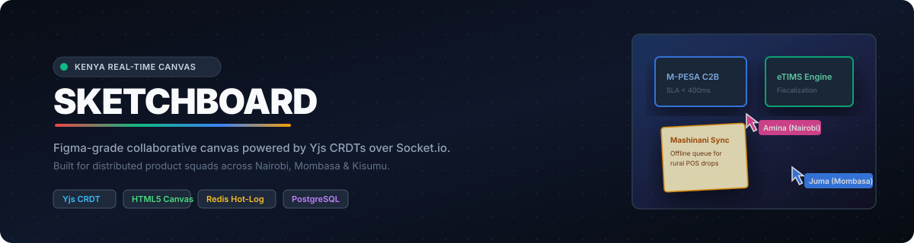
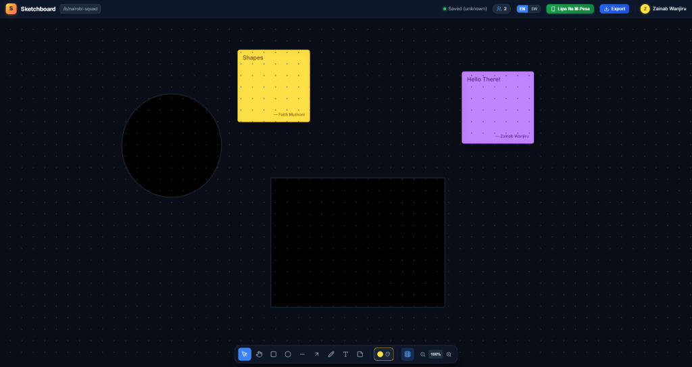
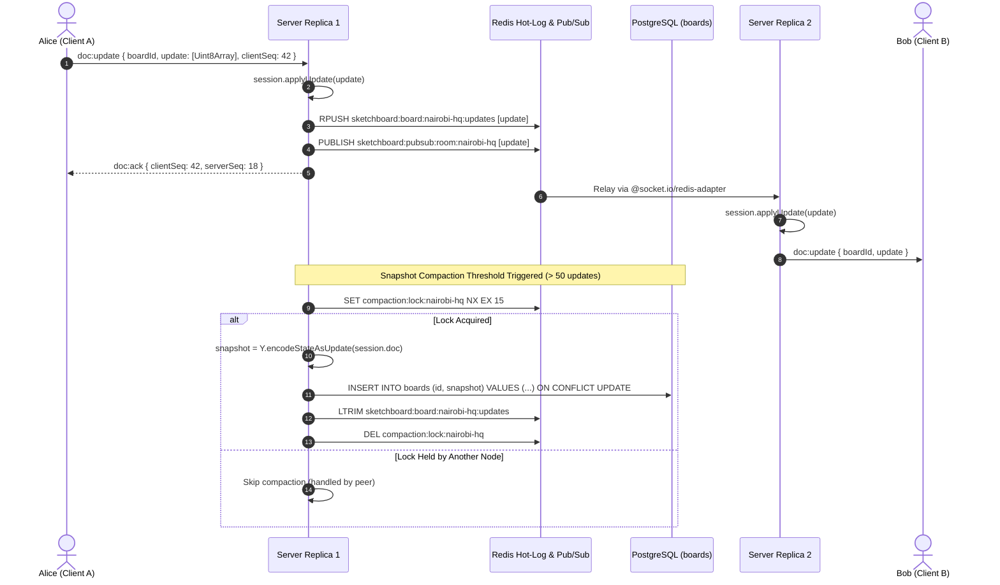
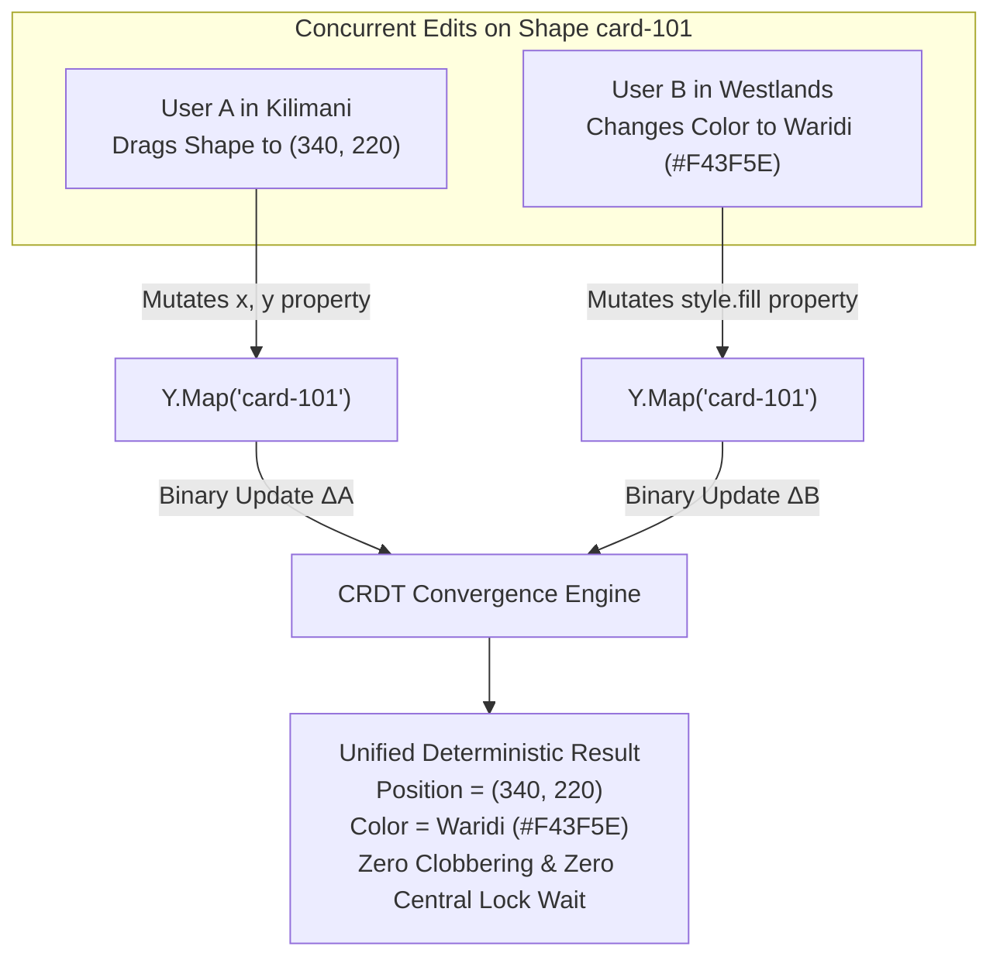

<p align="center">
  
</p>

<p align="center">
  <strong>A Figma-grade real-time collaborative canvas built for Kenyan design, fintech, and product squads.</strong><br>
  Dual-layer HTML5 Canvas &bull; Yjs CRDTs over Socket.io &bull; Redis Hot-Update Log &bull; Postgres Compaction &bull; Kubernetes Ready
</p>

<p align="center">
  <a href="https://crnjihia.github.io/sketchboard/"></a>
  <a href="https://github.com/crnjihia/sketchboard/releases/tag/v1.0.0"></a>
  <a href="https://github.com/crnjihia/sketchboard/actions/workflows/ci.yml"></a>
  <a href="#test-results"></a>
  <a href="#chaos-and-load-testing"></a>
  <a href="LICENSE"></a>
</p>

<p align="center">
  
</p>

<p align="center">
  <em>Live interactive Nairobi squad session (<code>/b/nairobi-squad</code>) showing multi-user collaboration between Zainab Wanjiru and Faith Muthoni, featuring Swahili sticky notes, geometric shapes, bilingual EN/SW toggle, and native Lipa Na M-Pesa billing.</em>
</p>

---

## Table of Contents

1. [Problem Statement & Kenyan Context](#problem-statement--kenyan-context)
2. [Key Architecture Decisions](#key-architecture-decisions)
3. [System Architecture Diagram](#system-architecture-diagram)
4. [Real-Time Sync Protocol](#real-time-sync-protocol)
5. [How Conflicts Resolve: Property-Level CRDT vs OT](#how-conflicts-resolve-property-level-crdt-vs-ot)
6. [Sticky Sessions Strategy](#sticky-sessions-strategy)
7. [Kenyan FinTech: Lipa Na M-Pesa & SMS Subsystems](#kenyan-fintech-lipa-na-m-pesa--sms-subsystems)
8. [What Is Real vs. Simulated](#what-is-real-vs-simulated)
9. [Kenyan Swahili Design Palette](#kenyan-swahili-design-palette)
10. [Repository Structure](#repository-structure)
11. [Quickstart & Operations](#quickstart--operations)
12. [Chaos & Load Benchmarks](#chaos--load-benchmarks)
13. [Architectural Decision Records (ADRs)](#architectural-decision-records-adrs)
14. [Contributing & Security](#contributing--security)

---

## Problem Statement & Kenyan Context

Kenya's digital product ecosystem is one of the most vibrant in Africa, spanning fintech unicorns (M-PESA, equity rails), agritech, and pan-African logistics. However, engineering and design teams face unique infrastructure realities:

- **Distributed Squads Across Uneven Networks**: Designers and product managers collaborate remotely between Nairobi (Kilimani, Westlands), Mombasa, Kisumu, Nakuru, and Eldoret. Edge cellular connections (Safaricom 4G/5G, Airtel, rural microwave relays) occasionally drop packets or introduce jitter.
- **Traditional Cloud Latency Bottlenecks**: Global SaaS whiteboards often route WebSockets through European or US nodes, causing 180ms–350ms input lag. Designers experience rubber-banding, dropped strokes, and disconnected sessions.
- **Heavy Canvas Bloat**: Browser tab crashes are frequent when running bulky third-party canvas engines over machines with constrained RAM.

**Sketchboard** solves this with a lightweight, multi-layer **HTML5 2D Canvas engine (zero external canvas dependencies)**, paired with **Yjs binary state vectors carried over a unified Socket.io transport**, backed by **Redis hot-update logs** and **PostgreSQL compaction**. When a network drop occurs on the train between Nairobi and Mombasa, edits are queued in an optimistic outbox and merge conflict-free upon reconnection.

---

## Key Architecture Decisions

- **Monorepo (pnpm workspaces)**: `@sketchboard/shared` (Zod schemas, CRDT document model, Swahili palette), `@sketchboard/server` (Socket.io clustering, Redis hot log, Postgres compaction), `@sketchboard/web` (React 18 + Vite + custom dual-layer HTML5 Canvas), `deploy/compose`, and `deploy/k8s`.
- **Property-Level CRDT Granularity**: The canvas document is represented as a single `Y.Doc` with `Y.Map<string, Y.Map<string, any>>` ("objects") and `Y.Array<string>` ("zOrder"). If User A drags an object's position while User B changes its fill color, **both edits merge deterministically**.
- **Volatile Cursors Outside the CRDT**: Remote cursor positions, selections, and user presences bypass the CRDT document entirely. They are broadcast as volatile Socket.io events with peer-side interpolation at 60fps, preventing document bloat and memory leaks.
- **Dual-Layer HTML5 Canvas Engine**: The viewport consists of an underlying **Scene Canvas** (redrawn only when document objects mutate) and an overlying transparent **Overlay Canvas** (redrawn at 60fps for marquee selections, resize handles, and live cursor animations).
- **Sub-millisecond Spatial Indexing**: A uniform `SpatialGrid` partitions canvas space into 256px cells, delivering $O(1)$ viewport culling queries in under 0.6ms even with 2,000 active shapes.

---

## System Architecture Diagram

```mermaid
graph TD
    subgraph Edge ["Client Layer (Browsers & Tablets)"]
        Client1["Client A (Nairobi)\nHTML5 Dual-Layer Canvas Engine\nLocal Y.Doc + Optimistic Outbox"]
        Client2["Client B (Mombasa)\nHTML5 Dual-Layer Canvas Engine\nLocal Y.Doc + Optimistic Outbox"]
    end

    subgraph LoadBalancer ["Ingress & Routing Tier"]
        NGINX["NGINX Load Balancer / K8s Ingress\nSticky: ip_hash / Session Cookie\nWebSocket Upgrade & Timeout = 3600s"]
    end

    subgraph ApplicationCluster ["Stateless Application Cluster (sketchboard namespace)"]
        Server1["Server Replica 1 (Node.js 22)\nSocket.io + In-Memory Session Cache\nRate Limiter + Prometheus /metrics"]
        Server2["Server Replica 2 (Node.js 22)\nSocket.io + In-Memory Session Cache\nRate Limiter + Prometheus /metrics"]
    end

    subgraph MessagingTier ["Distributed Relay & Memory Tier"]
        RedisAdapter["Redis 7 Cluster\n@socket.io/redis-adapter Pub/Sub Relay"]
        HotLog["Redis Hot Update Log\nAppend-Only Stream per Board"]
    end

    subgraph PersistenceTier ["Compacted Storage Tier"]
        Postgres["PostgreSQL 16\nCompacted Binary Snapshots (boards table)"]
    end

    Client1 <-->|HTTP Long-Polling / WSS| NGINX
    Client2 <-->|HTTP Long-Polling / WSS| NGINX

    NGINX <-->|Pinned Session| Server1
    NGINX <-->|Pinned Session| Server2

    Server1 <-->|Pub/Sub Relay| RedisAdapter
    Server2 <-->|Pub/Sub Relay| RedisAdapter

    Server1 -->|appendHotUpdate()| HotLog
    Server2 -->|appendHotUpdate()| HotLog

    Server1 -.->|Distributed Lock Compaction| Postgres
    Server2 -.->|Distributed Lock Compaction| Postgres
```

---

## Real-Time Sync Protocol



---

## How Conflicts Resolve: Property-Level CRDT vs OT



The property-level CRDT model separates each shape property into distinct register slots. When User A updates spatial coordinates while User B updates background fill, both operations succeed simultaneously without manual conflict resolution.

---

## Sticky Sessions Strategy

When scaling Socket.io horizontally across Kubernetes pods or Docker containers, clients initially perform an HTTP long-polling handshake before upgrading to WebSockets.
- **NGINX Load Balancer**: Uses `ip_hash` (or `sketchboard_affinity` cookie) to pin each client to a single backend replica during the handshake.
- **WebSocket Upgrade**: Once upgraded, the persistent TCP socket remains bound to the pod, while all inter-node event relays flow over Redis pub/sub.

---

## Kenyan FinTech: Lipa Na M-Pesa & SMS Subsystems

Sketchboard natively accommodates the realities of East Africa's leading technology hub by incorporating Safaricom M-Pesa mobile money billing and Africa's Talking SMS alerts.

### 1. Lipa Na M-Pesa Online (STK Push)
- **Direct Handset Prompts**: When a user upgrades their workspace (Free, Pro Squad at KES 150/mo, Enterprise at KES 500/mo), entering their Safaricom number (`07XXXXXXXX` or `01XXXXXXXX`) triggers an automated SIM toolkit prompt requesting their M-Pesa PIN.
- **CBK Transaction Guardrails**: Built-in validation enforces Central Bank of Kenya single-transaction thresholds (KES 1 to KES 250,000).
- **Asynchronous Webhook Reconciliation**: Safaricom `stkCallback` payloads are ingested, cryptographically verified, and recorded in an idempotent `PostgresPaymentLedger` (with zero-config in-memory fallback).
- **Zero-Credential Developer Mock**: With `MPESA_MOCK=true` (the default), developers and automated test suites can simulate immediate PIN confirmations (`[Simulate PIN Success]`) or cancellations (`ResultCode: 1032`) directly from the UI without real credentials or network tunnels.

### 2. Africa's Talking Cellular SMS Gateway
- **Collaborator SMS Invites**: Squad leads can invite colleagues across Kenya and East Africa directly by phone number, sending automated SMS invites containing one-click join URLs.
- **SMS Transaction Receipts**: Upon payment confirmation, customers receive an SMS receipt citing their Safaricom receipt code and active plan expiration.
- **Synthetic Inspectable Outbox**: When operating in mock mode (`AFRICASTALKING_MOCK=true`), messages are held in an in-memory outbox queryable at `/api/notifications/sms/outbox` for frictionless assertions during automated E2E and unit testing.

### 3. Bilingual English & Kiswahili Interface
The user interface features instantaneous language toggling between English and Kiswahili (`sw`), with full translations across canvas controls, connection statuses, M-Pesa checkout dialogs, and workspace tier badges.

---

## What Is Real vs. Simulated

| Component | Status | Implementation Details |
| :--- | :--- | :--- |
| **CRDT Collaboration** | **100% Real** | Full Yjs binary encoding over Socket.io with property-level merging. |
| **HTML5 Canvas Engine** | **100% Real** | Hand-rolled dual-layer 2D canvas with spatial grid indexing and 60fps HUD. |
| **Redis Hot-Log & Relay** | **100% Real** | Redis streams/lists for hot log and `@socket.io/redis-adapter` for multi-node clustering. |
| **PostgreSQL Compaction** | **100% Real** | Distributed lock compaction storing compact binary snapshots in PostgreSQL. |
| **M-Pesa Daraja Payments** | **Real Sandbox / Mock** | Safaricom Daraja STK Push sandbox with a complete local mock adapter (`MPESA_MOCK=true`). |
| **Africa's Talking SMS** | **Real Sandbox / Mock** | SMS gateway sandbox integration with a zero-credential mock adapter (`AFRICASTALKING_MOCK=true`). |

---

## Kenyan Swahili Design Palette

| Token | Swahili Name | Hex Code | Purpose |
| :--- | :--- | :--- | :--- |
| `njano` | **Njano** | `#FDE047` | Nairobi Sun yellow (default sticky notes & ideas) |
| `waridi` | **Waridi** | `#FB7185` | Rose pink (critical blockers & alerts) |
| `kijani` | **Kijani** | `#4ADE80` | Safari green (approved designs & success badges) |
| `buluu` | **Buluu** | `#60A5FA` | Rift sky blue (fintech architectures & data pipelines) |
| `zambarau` | **Zambarau** | `#C084FC` | Royal purple (user journeys & executive summaries) |
| `chungwa` | **Chungwa** | `#FB923C` | Savannah orange (review requests & warnings) |
| `kivuli` | **Kivuli** | `#1E293B` | Night slate (dark mode canvas backing & card borders) |

---

## Repository Structure

```
sketchboard/
├── apps/
│   ├── server/       # Node.js 22 LTS, Socket.io, Redis hot-log, Postgres storage
│   └── web/          # React 18, Vite, Dual-layer Canvas Engine, Zustand, i18n
├── packages/
│   └── shared/       # Zod schemas, CRDT document manager, spatial grid, Swahili palette
├── deploy/
│   ├── compose/      # 2-node Docker Compose with NGINX load balancer
│   └── k8s/          # Kubernetes Kustomize manifests (Deployments, HPA, PDB, Ingress)
├── docs/             # Architecture, ADRs, performance benchmarks, releasing guide
├── e2e/              # Playwright multi-browser collaboration & undo/redo test suites
└── scripts/          # Chaos failover tester, 50-socket cluster load tester, demo seeder
```

---

## Quickstart & Operations

### Prerequisites
- Node.js `>= 20.0.0`
- `pnpm` `>= 9.0.0`
- Docker & Docker Compose (optional for cluster testing)

### Local Development
```bash
# 1. Install dependencies
pnpm install

# 2. Run unit & integration test suite
pnpm test

# 3. Start local development servers (web + server)
pnpm dev
```
Open [http://localhost:5173](http://localhost:5173) in your browser.

### Docker Compose 2-Node Cluster
```bash
# Launch 2 server replicas, Redis 7, Postgres 16, web container, and NGINX
docker compose -f deploy/compose/docker-compose.yml up --build -d

# Verify health probes
curl http://localhost:8080/healthz
curl http://localhost:8080/readyz
curl http://localhost:8080/metrics
```
Access the clustered application at [http://localhost:8080](http://localhost:8080).

---

## Chaos & Load Benchmarks

### 1. Chaos Pod Crash Failover (`pnpm test:chaos`)
Validates that when a server pod crashes abruptly mid-session, clients fail over to survivor replicas with **0 lost edits**:
```bash
pnpm test:chaos
```

### 2. High-Density Cluster Load Benchmark (`pnpm test:load`)
Simulates 50 concurrent users across 10 active boards emitting 30 cursor updates/sec and 1 edit/sec:
```bash
pnpm test:load
```

### 3. Multi-Browser Collaboration E2E (`pnpm test:e2e`)
Runs automated Playwright verification across isolated browser contexts simulating multiple engineers collaborating simultaneously:
```bash
pnpm test:e2e
```

---

## Architectural Decision Records (ADRs)

Detailed rationale behind every engineering decision is documented in `docs/adr/`:
- [ADR 0001: Monorepo Structure & Tooling](docs/adr/0001-monorepo-structure.md)
- [ADR 0002: Yjs Transport Over Socket.io](docs/adr/0002-yjs-over-socketio.md)
- [ADR 0003: Property-Level CRDT Document Model](docs/adr/0003-property-level-crdt-model.md)
- [ADR 0004: Redis Hot-Log & PostgreSQL Snapshot Compaction](docs/adr/0004-redis-hot-log-compaction.md)
- [ADR 0005: Sticky Sessions Strategy](docs/adr/0005-sticky-sessions-strategy.md)
- [ADR 0006: Volatile Cursors Outside the CRDT](docs/adr/0006-cursors-outside-crdt.md)
- [ADR 0007: CRDT vs Operational Transformation (OT)](docs/adr/0007-crdt-vs-ot.md)
- [ADR 0008: Safaricom Daraja 2.0 M-Pesa STK Push Integration & Mock Adapter](docs/adr/0008-mpesa-daraja-mock-adapter.md)
- [ADR 0009: Africa's Talking SMS Gateway & Collaborator Notification Subsystem](docs/adr/0009-africas-talking-sms-gateway.md)

---

## Contributing & Security

- **Contributing**: Please review [CONTRIBUTING.md](CONTRIBUTING.md) for Conventional Commits and code style.
- **Security**: Vulnerability reporting details are documented in [SECURITY.md](SECURITY.md).
- **Author**: Chris (Christopher Njihia), Nairobi, Kenya (`crnjihia@gmail.com`).
- **License**: MIT License &bull; Free and open-source.
