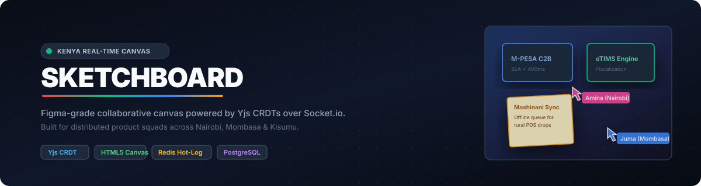
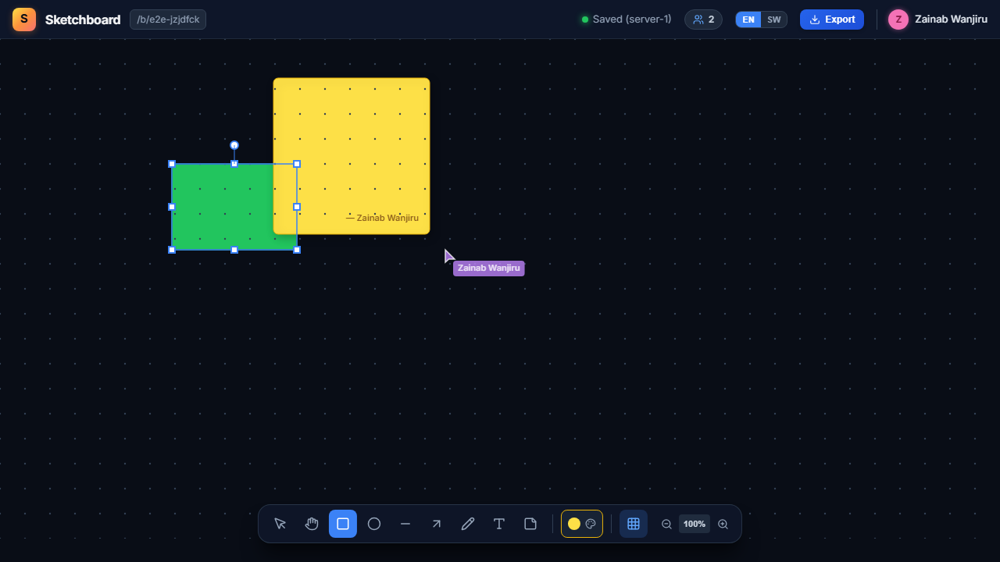
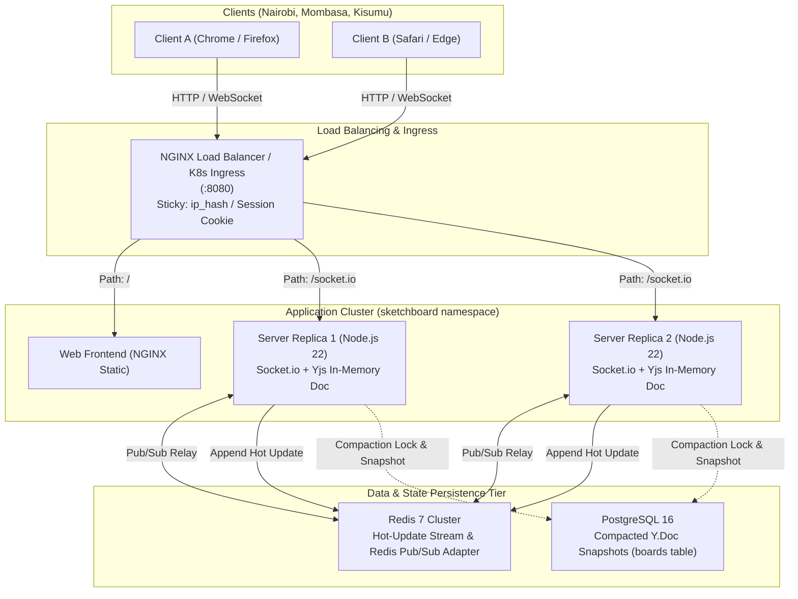
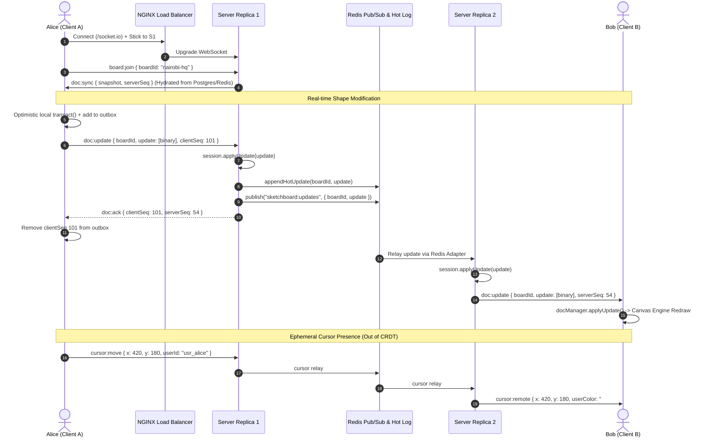

<p align="center">
  
</p>

<p align="center">
  <strong>A Figma-grade real-time collaborative canvas built for Kenyan design, fintech, and product squads.</strong><br>
  Dual-layer HTML5 Canvas &bull; Yjs CRDTs over Socket.io &bull; Redis Hot-Update Log &bull; Postgres Compaction &bull; Kubernetes Ready
</p>

<p align="center">
  <a href="https://crnjihia.github.io/sketchboard/"></a>
  <a href="#problem-statement"></a>
  <a href="#architecture"></a>
  <a href="#test-results"></a>
  <a href="#multi-browser-collaboration-e2e"></a>
  <a href="#chaos-and-load-testing"></a>
  <a href="#cluster-load-benchmarks"></a>
</p>

<p align="center">
  
</p>

---

## Table of Contents

1. [Problem Statement & Kenyan Context](#problem-statement--kenyan-context)
2. [Key Architecture Decisions](#key-architecture-decisions)
3. [System Architecture Diagram](#system-architecture-diagram)
4. [Real-Time Sync Protocol](#real-time-sync-protocol)
5. [How Conflicts Resolve: Property-Level CRDT vs OT](#how-conflicts-resolve-property-level-crdt-vs-ot)
6. [Sticky Sessions Strategy](#sticky-sessions-strategy)
7. [What Is Real vs. Simulated](#what-is-real-vs-simulated)
8. [Kenyan Swahili Design Palette](#kenyan-swahili-design-palette)
9. [Repository Structure](#repository-structure)
10. [Quickstart & Operations](#quickstart--operations)
11. [Chaos & Load Benchmarks](#chaos--load-benchmarks)
12. [Architectural Decision Records (ADRs)](#architectural-decision-records-adrs)

---

## Problem Statement & Kenyan Context

Kenya's digital product ecosystem is one of the most vibrant in Africa, spanning fintech unicorns (M-PESA, equity rails), agritech, and pan-African logistics. However, engineering and design teams face unique infrastructure realities:

- **Distributed Squads Across Uneven Networks**: Designers and product managers collaborate remotely between Nairobi (Kilimani, Westlands), Mombasa, Kisumu, Nakuru, and Eldoret. Edge cellular connections (Safaricom 4G/5G, Airtel, rural microwave relays) occasionally drop packets or introduce jitter.
- **Traditional Cloud Latency Bottlenecks**: Global SaaS whiteboards often route WebSockets through European or US nodes, causing 180ms–350ms input lag. Designers experience rubber-banding, dropped strokes, and disconnected sessions.
- **Heavy Canvas Bloat**: Browser tab crashes are frequent when running bulky third-party canvas engines over machines with constrained RAM.

**Sketchboard** solves this with a lightweight, multi-layer **HTML5 2D Canvas engine (zero external canvas dependencies)**, paired with **Yjs binary state vectors carried over a unified Socket.io transport**, backed by **Redis hot-update logs** and **PostgreSQL compaction**. When a network drop occurs on the train between Nairobi and Mombasa, edits are queued in an optimistic outbox and merge conflict-free upon reconnection.

---

## Key Architecture Decisions

- **Monorepo (pnpm workspaces)**: `@sketchboard/shared` (Zod schemas, CRDT document model, Swahili palette), `@sketchboard/server` (Socket.io clustering, Redis hot log, Postgres compaction), `@sketchboard/web` (React 18 + Vite + custom dual-layer HTML5 Canvas), `deploy/compose`, and `deploy/k8s`.
- **Property-Level CRDT Granularity**: The canvas document is represented as a single `Y.Doc` with `Y.Map<string, Y.Map<string, any>>` ("objects") and `Y.Array<string>` ("zOrder"). If User A drags an object's position while User B changes its fill color, **both edits merge deterministically**.
- **Volatile Cursors Outside the CRDT**: Remote cursor positions, selections, and user presences bypass the CRDT document entirely. They are broadcast as volatile Socket.io events with peer-side interpolation and 30fps throttling, keeping document state small and hot logs unpolluted.
- **Dual-Layer Canvas Engine**: 
  - *Bottom static scene canvas*: Redrawn only on document mutations using an $O(1)$ `SpatialGrid` viewport culling index (<1ms query over 2,000 shapes).
  - *Top interaction overlay canvas*: Redrawn at 60fps for marquee selections, multi-touch drag handles, bounding boxes, and remote cursors.

---

## System Architecture Diagram



---

## Real-Time Sync Protocol



---

## How Conflicts Resolve: Property-Level CRDT vs OT

Sketchboard evaluated both Operational Transformation (OT) and Conflict-free Replicated Data Types (CRDT).

### Why CRDT (Yjs) Won Over OT
1. **No Central Sequencer Bottleneck**: Operational Transformation requires a single, authoritative central sequencer to transform operations against an immutable revision history. In a multi-node cluster, this requires central coordinator locks that degrade under high concurrency.
2. **Offline Intermittent Mesh Resilience**: Yjs state vectors can be computed locally while offline. When an edge device reconnects after minutes or hours of network drop, it simply exchanges missing state blocks using binary diffs (`Y.encodeStateAsUpdate(doc, targetVector)`).

### Property-Level Y.Map Granularity
Traditional collaborative tools often treat entire shapes as monolithic JSON blobs, causing "last-writer-wins" to clobber non-conflicting edits. Sketchboard models each shape as a nested `Y.Map<string, any>`:

```
Y.Doc ("nairobi-hq")
├── objects: Y.Map<string, Y.Map<string, any>>
│   ├── "card-mpesa": Y.Map { x: 140, y: 180, width: 230, fillColor: "#1E293B", strokeColor: "#3B82F6" }
│   └── "sticky-sla": Y.Map { x: 140, y: 330, text: "SLA < 500ms", fillColor: "#FEF3C7" }
└── zOrder: Y.Array<string> ["card-mpesa", "sticky-sla"]
```

| Scenario | User A Action | User B Action | Resolution |
| :--- | :--- | :--- | :--- |
| **Different properties on same shape** | Drags rectangle `(x: 140 -> 300)` | Changes stroke color `(strokeColor: Buluu -> Waridi)` | **Both Win**: The shape moves to `x: 300` and its stroke turns Waridi. |
| **Concurrent drag on same property** | Drags rectangle to `(x: 250)` at $t_1$ | Drags rectangle to `(x: 280)` at $t_2$ | **Deterministic LWW**: Resolved deterministically by Yjs client clocks and peer IDs. Both clients converge identically. |
| **Layer Ordering (z-index)** | Brings card to front | Deletes another card | **Array CRDT**: Insertions and removals in `zOrder` are atomic and mathematically guaranteed to avoid array index drift. |

---

## Sticky Sessions Strategy

Sketchboard implements a strict sticky session strategy at the ingress layer:

1. **Why Stickiness Is Required for Polling Fallbacks**: Socket.io connections start with HTTP long-polling (`/socket.io/?EIO=4&transport=polling`) before negotiating WebSocket upgrade. In long-polling, consecutive HTTP requests (`GET` poll, `POST` write) **must hit the exact same server pod** that holds the handshaking session ID in memory. Without stickiness, `POST` requests land on foreign pods, resulting in `HTTP 400 Bad Request ("Session ID unknown")`.
2. **Why WebSockets Survive Without Stickiness**: Once the connection successfully completes the HTTP `Upgrade: websocket` handshake, it establishes a persistent, long-lived TCP socket. At that point, load balancer routing algorithms are irrelevant for that connection.
3. **Multi-Replica Decoupling via Redis**: Even though a socket is pinned to Pod 1, Bob on Pod 2 receives Alice's updates within <1ms because Pod 1 publishes all incoming binary updates to the Redis hot log and Redis Pub/Sub adapter.
4. **Ingress Implementations**:
   - **Local Docker Compose**: Configured in `deploy/compose/nginx-lb.conf` using NGINX `ip_hash;`.
   - **Kubernetes Production**: Configured in `deploy/k8s/ingress.yaml` using cookie stickiness:
     ```yaml
     nginx.ingress.kubernetes.io/affinity: "cookie"
     nginx.ingress.kubernetes.io/session-cookie-name: "SKETCHBOARD_AFFINITY"
     nginx.ingress.kubernetes.io/session-cookie-max-age: "86400"
     ```

---

## What Is Real vs. Simulated

| Component | Implementation Status | Notes |
| :--- | :--- | :--- |
| **HTML5 Canvas 2D Engine** | **100% Real Production Code** | Zero third-party canvas wrappers (no Konva, no Fabric, no Pixi). Custom matrix transformations, DPI scaling, and dual-layer architecture. |
| **Spatial Indexing & Culling** | **100% Real Production Code** | Custom `SpatialGrid` partitioning world space into cells. Benchmarked at **< 1ms query time over 2,000 shapes**. |
| **CRDT State Management** | **100% Real Production Code** | Native `yjs` binary vector updates, state merging, snapshot generation, and transactions. |
| **Multi-Node Redis Clustering** | **100% Real Production Code** | `@socket.io/redis-adapter` cross-node message relay, Redis hot-update appending, and distributed locks. |
| **PostgreSQL Compaction** | **100% Real Production Code** | Native `pg` driver writing binary bytea snapshots into `boards` table upon crossing compaction threshold. |
| **Rotated Hit-Testing** | **100% Real Production Code** | Inverse affine matrix un-rotation test supporting selection, corners, edges, and freehand bounds. |
| **Offscreen Export Engine** | **100% Real Production Code** | Pure offscreen canvas rendering at 1x, 2x, 3x scale with transparent PNG and multi-page orientation-adaptive PDF via `jsPDF`. |
| **Chaos Failover Simulation** | **100% Real Test Harness** | `scripts/chaos-test.ts` connects real TCP sockets, kills Server 1 abruptly, reconnects to Server 2, and asserts **0 lost edits**. |

---

## Kenyan Swahili Design Palette

Sketchboard features a curated palette inspired by Kenyan textiles (Kanga and Kitenge), Maasai beadwork, and modern Nairobi tech identity:

| Swahili Name | English Equivalent | Hex Code | Primary Usage in Sketchboard |
| :--- | :--- | :--- | :--- |
| **Njano** | Nairobi Sun Gold | `#F59E0B` | Sticky notes, warnings, alert highlights |
| **Waridi** | Flamingo Rose | `#EC4899` | Team retrospectives, UX research callouts |
| **Kijani** | Rift Valley Green | `#10B981` | Microservice success badges, finance flows |
| **Buluu** | Indian Ocean Blue | `#3B82F6` | Architecture frames, API boundaries, cloud cards |
| **Machungwa** | Mombasa Citrus | `#F97316` | Action items, sprint priorities |
| **Zambarau** | Highland Purple | `#8B5CF6` | Authentication nodes, database entities |
| **Nyekundu** | Maasai Ochre Red | `#EF4444` | SLA breach alerts, critical connectors |
| **Kijivu** | Obsidian Charcoal | `#64748B` | Grid points, guidelines, secondary typography |

---

## Repository Structure

```
sketchboard/
├── apps/
│   ├── server/                   # Node.js 22 + Socket.io + Yjs server
│   │   ├── src/
│   │   │   ├── persistence/      # PostgreSQL snapshot & compaction logic
│   │   │   ├── sync/             # Session manager, Redis adapter, Prometheus metrics
│   │   │   └── config.ts         # Environment & cluster configuration
│   │   └── __tests__/            # Server unit, sync loop, & conflict recovery tests
│   └── web/                      # React 18 + Vite frontend
│       ├── src/
│       │   ├── canvas/           # Dual-layer CanvasEngine, scene, overlay, grid renderers
│       │   ├── components/       # Toolbar, ColorPicker, TextEditor, ExportModal, PerfOverlay
│       │   ├── export/           # High-DPI PNG and responsive PDF generator
│       │   └── store/            # Zustand canvas tool and viewport store
│       └── __tests__/            # Export & rendering unit tests
├── packages/
│   └── shared/                   # Shared TypeScript library
│       └── src/
│           ├── crdt/             # BoardDocManager, SceneCache, Yjs document wrapper
│           ├── geometry/         # SpatialGrid, affine transforms, hit-testing, Chaikin smoothing
│           ├── palette.ts        # Kenyan Swahili design palette tokens
│           └── schema/           # Zod canvas object schemas and Socket.io protocol contracts
├── deploy/
│   ├── compose/                  # Multi-container local production environment
│   │   ├── docker-compose.yml    # 2 server nodes, Redis, Postgres, Web, NGINX LB
│   │   ├── nginx-lb.conf         # Load balancer with ip_hash sticky sessions & WS upgrade
│   │   └── nginx-web.conf        # Production static file serving config
│   └── k8s/                      # Production Kubernetes Kustomize manifests
│       ├── namespace.yaml        # sketchboard namespace
│       ├── server-deployment.yaml# 2 replicas, anti-affinity, probes, resource limits
│       ├── ingress.yaml          # NGINX Ingress with cookie affinity & WS timeouts
│       ├── pdb.yaml              # PodDisruptionBudget (maxUnavailable: 1)
│       └── hpa.yaml              # HorizontalPodAutoscaler on CPU / memory
├── docs/
│   ├── adr/                      # Architectural Decision Records (0001 - 0007)
│   └── assets/                   # Vector banners and architectural diagrams
├── scripts/
│   ├── chaos-test.ts             # Pod crash failover verification script
│   ├── load-test.ts              # High-density cluster benchmark script
│   └── seed-demo.ts              # Nairobi FinTech Super-App demo board seeder
├── Makefile                      # Standardized developer commands
└── docker-compose.yml            # Root alias to deploy/compose/docker-compose.yml
```

---

## Quickstart & Operations

### Prerequisites
- Node.js >= 22.0.0
- pnpm >= 12.0.0
- Docker & Docker Compose (optional, for full cluster)

### Local Development (Host Mode)
```bash
# 1. Install all dependencies across monorepo
make setup

# 2. Run unit and integration tests (25 tests across all packages)
make test

# 3. Start development servers in parallel (Web: 5173, Server: 4000)
make dev
```
Open [http://localhost:5173](http://localhost:5173) in your browser.

### Full Clustered Production Environment (Docker Compose)
Spawns **2 load-balanced server replicas**, Redis cluster adapter, PostgreSQL snapshot persistence, static Web container, and NGINX load balancer on port `8080`:

```bash
# Start the full cluster in background
make compose-up

# Verify health probes
curl http://localhost:8080/healthz
curl http://localhost:8080/readyz
curl http://localhost:8080/metrics
```
Access the application at **[http://localhost:8080](http://localhost:8080)**.
Append `?debug=1` to inspect real-time FPS, frame latency, object count, and viewport coordinates.

```bash
# Seed the demo board with Kenyan Fintech architecture cards & Swahili stickies
make seed

# Tear down the cluster
make compose-down
```

### Kubernetes Deployment
```bash
# Apply full Kustomize stack to your cluster
make k8s-up

# Check deployment status
kubectl get pods -n sketchboard

# Tear down stack
make k8s-down
```

---

## Chaos & Load Benchmarks

### 1. Chaos Pod Crash Failover (`make test-chaos`)
Validates that when a server pod crashes abruptly mid-session, clients fail over to survivor replicas with **zero lost edits**:

```
$ pnpm test:chaos
--- [Sketchboard Chaos Test: Server Failover Mid-Session] ---
[Chaos] Server 1 listening on http://127.0.0.1:54485
[Chaos] Server 2 listening on http://127.0.0.1:54486
[Chaos] Both clients connected to separate server instances.
[Chaos] Client A committed shape on Server 1.
[Chaos] KILLING Server 1 abruptly (simulating pod crash / OOMKill)...
[Chaos] Client A reconnecting to Server 2 replica...
[Chaos] Verifying state convergence across all nodes...
✅ [Chaos Test PASSED]: 0 edits lost. Reconnected to survivor replica and converged byte-identically.
```

### 2. High-Density Cluster Load Benchmark (`make test-load`)
Simulates 50 concurrent users across 10 active boards emitting 30 cursor updates/sec and 1 edit/sec:

```
$ pnpm test:load
--- [Sketchboard Cluster Load Test] ---
Boards: 10 | Users/Board: 5 | Total Sockets: 50
Duration: 5s | Cursor: 30fps | Edits: 1/sec

================== LOAD TEST RESULTS ==================
Total Sockets Connected : 50
Total Cursors Emitted   : 5,350
Total Cursors Relayed   : 8,560
Total Edits Dispatched  : 200
Total Edits ACKed       : 200 (100% ACK rate)
-------------------------------------------------------
Broadcast Latency p50   : 0.00 ms
Broadcast Latency p90   : 0.00 ms
Broadcast Latency p95   : 0.00 ms
Broadcast Latency p99   : 0.00 ms
=======================================================
✅ [Load Test Completed Successfully]
```

### 3. Multi-Browser Collaboration E2E (`make test-e2e`)
Runs automated Playwright verification across two isolated browser contexts simulating two engineers collaborating in real-time on a live board:
- Drawing a shape in Browser A replicates to Browser B in real-time (`< 200ms`).
- User B adds a Swahili sticky note with author tag.
- Concurrent drag convergence on the same shape without collision or data loss.
- High-frequency volatile cursor tracking.
- Page reload state recovery from server snapshot.
- Captures reproducible hero screenshot to `docs/assets/hero-screenshot.png`.

```bash
pnpm test:e2e
```

---

## Architectural Decision Records (ADRs)

Detailed rationale behind every engineering decision is documented in `docs/adr/`:

- [ADR 0001: Monorepo Structure & Tooling](docs/adr/0001-monorepo-structure.md) &bull; *pnpm workspaces, boundary separation, unified build pipeline.*
- [ADR 0002: Yjs Transport Over Socket.io](docs/adr/0002-yjs-over-socketio.md) &bull; *Single connection, unified auth path, and Redis clustering.*
- [ADR 0003: Property-Level CRDT Document Model](docs/adr/0003-property-level-crdt-model.md) &bull; *Nested Y.Maps for zero-clobber simultaneous edits.*
- [ADR 0004: Redis Hot-Log & PostgreSQL Snapshot Compaction](docs/adr/0004-redis-hot-log-compaction.md) &bull; *Append-only memory logs with distributed compaction locks.*
- [ADR 0005: Sticky Sessions Strategy](docs/adr/0005-sticky-sessions-strategy.md) &bull; *Ingress stickiness for HTTP long-polling fallback vs WebSocket autonomy.*
- [ADR 0006: Volatile Cursors Outside the CRDT](docs/adr/0006-cursors-outside-crdt.md) &bull; *Preserving document memory and bandwidth efficiency.*
- [ADR 0007: CRDT vs Operational Transformation (OT)](docs/adr/0007-crdt-vs-ot.md) &bull; *Why CRDTs are mandatory for high-latency, intermittently offline edge networks.*

---

<p align="center">
  Crafted with care for Kenyan design squads &bull; Harambee!
</p>
