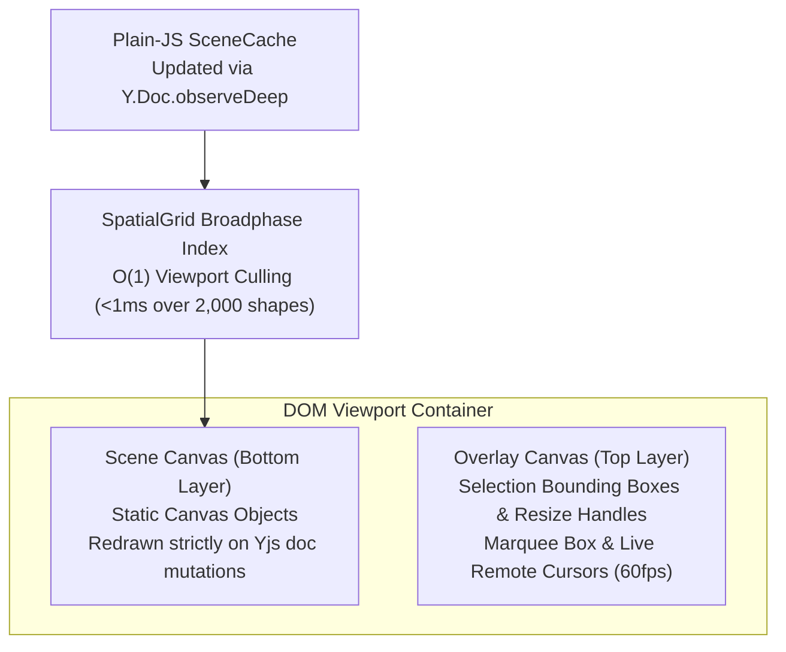
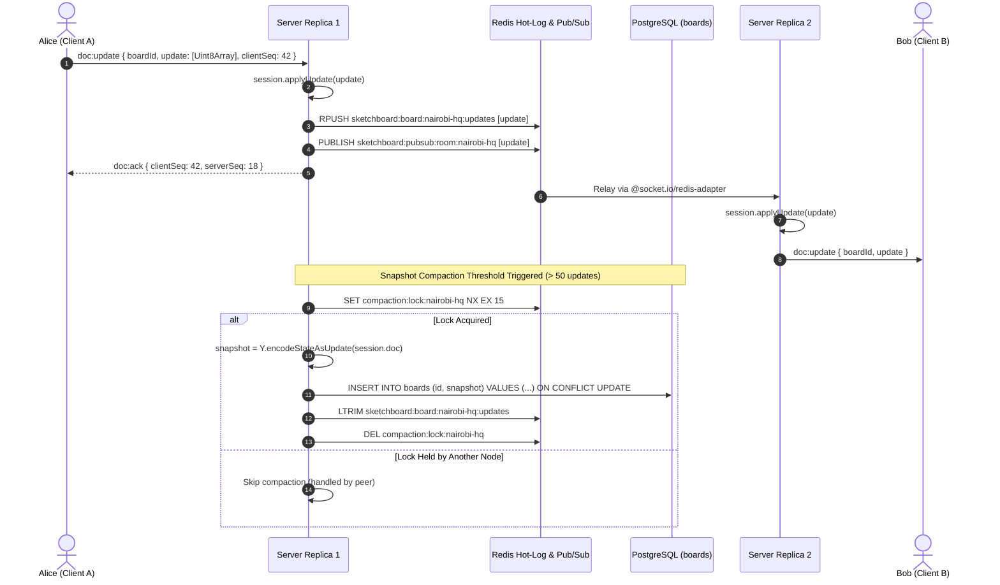

# Sketchboard Architecture Deep-Dive

This document details the architectural design, internal data structures, and distributed communication mechanisms powering **Sketchboard**.

---

## 1. System Topology Overview

Sketchboard is designed as a distributed, high-concurrency real-time canvas engine operating over heterogeneous networks.

```mermaid
graph TD
    subgraph Edge ["Client Layer (Browsers & Tablets)"]
        Client1["Client A (Nairobi)\nHTML5 Dual-Layer Canvas Engine\nLocal Y.Doc + Optimistic Outbox"]
        Client2["Client B (Mombasa)\nHTML5 Dual-Layer Canvas Engine\nLocal Y.Doc + Optimistic Outbox"]
    end

    subgraph LoadBalancer ["Ingress & Routing Tier"]
        NGINX["NGINX Load Balancer / K8s Ingress\nSticky: ip_hash / Session Cookie\nWebSocket Upgrade & Timeout = 3600s"]
    end

    subgraph ApplicationCluster ["Stateless Application Cluster (sketchboard namespace)"]
        Server1["Server Replica 1 (Node.js 22)\nSocket.io + In-Memory Session Cache\nRate Limiter + Prometheus /metrics"]
        Server2["Server Replica 2 (Node.js 22)\nSocket.io + In-Memory Session Cache\nRate Limiter + Prometheus /metrics"]
    end

    subgraph MessagingTier ["Distributed Relay & Memory Tier"]
        RedisAdapter["Redis 7 Cluster\n@socket.io/redis-adapter Pub/Sub Relay"]
        HotLog["Redis Hot Update Log\nAppend-Only Stream per Board"]
    end

    subgraph PersistenceTier ["Compacted Storage Tier"]
        Postgres["PostgreSQL 16\nCompacted Binary Snapshots (boards table)"]
    end

    Client1 <-->|HTTP Long-Polling / WSS| NGINX
    Client2 <-->|HTTP Long-Polling / WSS| NGINX

    NGINX <-->|Pinned Session| Server1
    NGINX <-->|Pinned Session| Server2

    Server1 <-->|Pub/Sub Relay| RedisAdapter
    Server2 <-->|Pub/Sub Relay| RedisAdapter

    Server1 -->|appendHotUpdate()| HotLog
    Server2 -->|appendHotUpdate()| HotLog

    Server1 -.->|Distributed Lock Compaction| Postgres
    Server2 -.->|Distributed Lock Compaction| Postgres
```

---

## 2. Document Data Model & CRDT Semantics

Sketchboard uses **Yjs** as its core Conflict-free Replicated Data Type engine. Each canvas board is encapsulated in a single `Y.Doc`.

### Granular Property-Level Y.Maps
Traditional collaborative applications frequently model objects as coarse-grained JSON objects. In Sketchboard, each object is a nested `Y.Map<string, any>`:

```
Y.Doc ("nairobi-hq")
├── objects: Y.Map<string, Y.Map<string, any>>
│   ├── "card-1": Y.Map {
│   │     id: "card-1",
│   │     type: "rectangle",
│   │     x: 140,
│   │     y: 180,
│   │     w: 230,
│   │     h: 110,
│   │     rotation: 0,
│   │     style: { fill: "#1E293B", stroke: "#3B82F6", strokeWidth: 2 }
│   │   }
└── zOrder: Y.Array<string> ["card-1", "card-2", "sticky-1"]
```

### Conflict Resolution Invariants:
1. **Property Isolation**: If User A mutates `x`/`y` while User B updates `style.fill`, both operations succeed with zero data clobbering.
2. **Concurrent Property Collision**: If both users drag the same shape concurrently, Yjs deterministically resolves the winner using the higher client clock and peer ID.
3. **Z-Order Ordering**: Layer reordering operates on an atomic `Y.Array<string>`. Layer insertions and deletions converge without index drift.

---

## 3. Dual-Layer Canvas Engine

The web frontend strictly avoids heavyweight canvas libraries (Fabric.js, Konva, Pixi.js) in favor of the standard browser Canvas 2D API.



### Why Dual Layers?
- Moving a remote cursor at 30fps would ordinarily trigger a 60fps full redraw of all 2,000 canvas objects.
- In Sketchboard, cursor interpolation and marquee selection are drawn onto the transparent **Overlay Canvas**, leaving the bottom **Scene Canvas** completely untouched until a document mutation actually occurs.

---

## 4. Multi-Node Replication & Compaction Lifecycle



---

## 5. Network Protocol Specifications

| Event | Direction | Payload | Semantics |
| :--- | :--- | :--- | :--- |
| `board:join` | Client &rarr; Server | `{ boardId, userId, userName }` | Joins board room and returns `nodeId` |
| `sync:step1` | Client &rarr; Server | `{ boardId, stateVector }` | Initiates Yjs state vector synchronization |
| `sync:step2` | Server &rarr; Client | `{ boardId, update }` | Returns binary delta missing on client |
| `doc:update` | Client &harr; Server | `{ boardId, update, clientSeq }` | Transmits local optimistic binary mutations |
| `doc:ack` | Server &rarr; Client | `{ clientSeq, serverSeq }` | Acknowledges receipt of client sequence |
| `cursor:move`| Client &rarr; Server | `{ boardId, userId, x, y }` | World-coordinate ephemeral cursor position |
| `cursor:remote`| Server &rarr; Client | `{ userId, userName, userColor, x, y }` | Volatile broadcast to other squad members |
